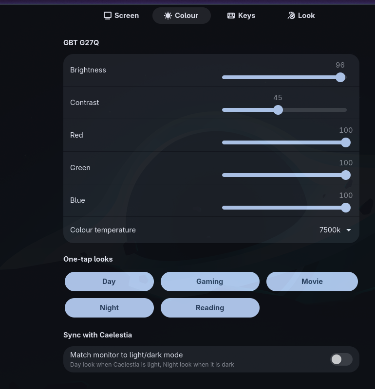
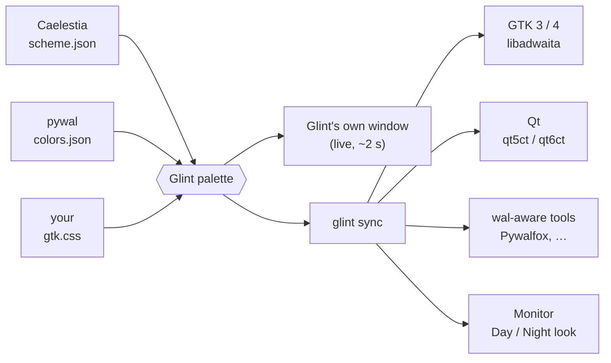
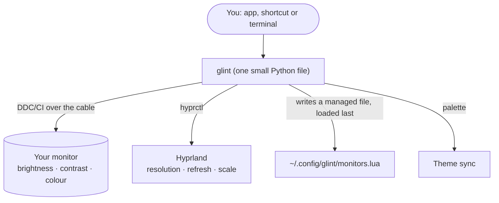

<div align="center">


<h1>✦ Glint</h1>

<p><i>your monitor, wearing your rice</i></p>

<a href="https://github.com/krvats/glint"></a>

<br>

[](https://github.com/krvats/glint/stargazers)
[](LICENSE)
[](https://hypr.land)
[](https://github.com/caelestia-dots)
[](#-works-on)

**[Install](#-install)** &nbsp;·&nbsp; **[Features](#-features)** &nbsp;·&nbsp; **[First five minutes](#-your-first-five-minutes)** &nbsp;·&nbsp; **[Looks like your rice](#-looks-like-your-rice)** &nbsp;·&nbsp; **[FAQ](#-faq)** &nbsp;·&nbsp; **[Roadmap](#-roadmap)**

<br>

<a href="https://commons.wikimedia.org/wiki/File:Tsunami_by_hokusai_19th_century.jpg"></a>

<sub><i>Katsushika Hokusai, “Under the Wave off Kanagawa”, c. 1830 to 1832. Public domain.<br>One quiet scene, one bright spark. That is the mood Glint is after.</i></sub>

<br><br>

### ✦ Install in one line

```bash
curl -fsSL https://raw.githubusercontent.com/krvats/glint/main/install.sh | bash
```

<sub>It downloads <b>one file</b>, not the repo. It installs what it needs, fixes monitor permissions, wires itself into your desktop and checks everything.<br>Want to read it first? <code>curl -fsSL https://raw.githubusercontent.com/krvats/glint/main/install.sh | less</code></sub>

</div>

<br>

> **Glint is a tiny control panel for the screen in front of you.**
> Pick a resolution and refresh rate from a list. Drag real brightness and colour sliders. Tap *Night* and your monitor warms up. And the whole thing wears **your** colours, whichever rice you run.

<br>

## 🌊 Why it exists

Setting 143.98 Hz usually means editing a Lua or `.conf` file and guessing. Brightness means a joystick hidden on the back of your monitor. And after all that, half your apps still don't match your theme. Glint puts it all in one small place.

|  | Without Glint | With Glint |
|---|---|---|
| **Refresh rate** | Edit `monitors.lua`, guess `143.98`, reload, hope | Pick it from a list. Auto-reverts in 12 s if the screen goes black |
| **Brightness / colour** | The monitor's own little buttons | Sliders, shortcuts and one-tap looks |
| **Matching your theme** | Per-app config files | Follows Caelestia / pywal live. GTK and Qt apps too |
| **Installing** | A page of steps per distro | One line |
| **Undoing it** | Hunt for what changed | `--uninstall` puts your files back |

<div align="center">

<br><sub><i>The Colour tab on a Caelestia desktop. Every rice looks different: share yours!</i></sub>
</div>

<br>

## 🌙 Features

<table>
<tr>
<td width="33%" valign="top">

### 🖥 Screen
Resolution and refresh rate from the list your monitor really offers, plus scale, rotation and position. Saved across reboots, with a 12-second safety revert.

</td>
<td width="33%" valign="top">

### ☀ Colour
Real hardware brightness, contrast, red/green/blue and colour temperature over DDC/CI. **0 is the monitor's true lowest, 100 its true highest.**

</td>
<td width="33%" valign="top">

### 🎨 Wears your rice
Reads Caelestia's scheme, pywal or your `gtk.css`. Change the scheme and Glint recolours itself in about two seconds.

</td>
</tr>
<tr>
<td valign="top">

### ⌨ Shortcuts that behave
`Super+Alt+…` for brightness and looks. Glint checks your existing binds first and **never overrides one**. Change any of them in the Keys tab.

</td>
<td valign="top">

### 🪟 Whole-desktop sync
Optionally themes GTK 3/4, libadwaita, Qt (qt5ct/qt6ct), Flatpak and Firefox (via Pywalfox) with the same colours. Your old files are backed up.

</td>
<td valign="top">

### 🧰 Does the boring part
Installs packages for your distro, adds the udev rule, the `i2c-dev` module and the `i2c` group, then runs a doctor so you know it works.

</td>
</tr>
</table>

### Three promises

| 🪶 Small | 🤝 Honest | ↩ Reversible |
|---|---|---|
| One Python CLI, one small GTK4 app, one installer file. | Tells you what it touched and what it can't do (see the [scope note](#-works-on)). | Backs up every file it edits. `--uninstall` puts them back. |

<br>

## 🚀 Install

```bash
curl -fsSL https://raw.githubusercontent.com/krvats/glint/main/install.sh | bash
```

No curl? `wget -qO- https://raw.githubusercontent.com/krvats/glint/main/install.sh | bash`

What you will see (colours trimmed):

```text
  ✦
 ┏━┓╻  ╻┏┓╻╺┳╸
 ┃╺┓┃  ┃┃┗┫ ┃
 ┗━┛┗━╸╹╹ ╹ ╹   v1.0.0

▸ Looking at your system
  ✓ CachyOS Linux (package manager: pacman)
▸ Installing what Glint needs
  ✓ packages ready
▸ Installing Glint into ~/.local
  ✓ glint, glint-gui and the launcher entry
▸ Letting you talk to your monitor without sudo
  ✓ udev rule, i2c-dev module and i2c group
▸ Wiring it into your desktop
  ✓ shortcuts added (Super+Alt+M opens Glint; taken keys were skipped)
  ✓ Synced GTK, Qt and wal-aware apps to caelestia (dark).  Auto-sync is on.
▸ Checking everything
  [OK] ddcutil found   [OK] theme: following caelestia   [OK] GBT G27Q (i2c-5)
✦ Done. Open Glint from your launcher, press Super+Alt+M, or run glint --help
```

| Option | Does |
|---|---|
| `--yes` | Ask nothing |
| `--no-deps` | Skip system packages |
| `--no-sync` | Don't theme other apps |
| `--no-keys` | Don't add shortcuts |
| `--dry-run` | Show what would happen, change nothing |
| `--uninstall` | Remove everything Glint added and put your files back (`--purge` also deletes saved settings) |

Pass options like this: `curl -fsSL <url> | bash -s -- --no-keys`

**After install:** open **Glint** from your launcher, or press <kbd>Super</kbd>+<kbd>Alt</kbd>+<kbd>M</kbd>. Log out and in once if the installer just added you to the `i2c` group.

### 🔄 Update

Run the same install line again. It upgrades in place and keeps your settings, shortcuts and theme sync.

### 🪄 Caelestia's brightness slider

Caelestia reads your monitor once and then trusts its own copy, so when Glint or a shortcut changes the brightness, Caelestia's slider and OSD could lag. Glint now tells the running shell through its own IPC, after checking what that Caelestia version offers (`glint shell-sync status` shows it). If your Caelestia has no brightness IPC, Glint says so once. Then `glint shell-sync restart` makes it refresh by restarting the shell (at most once every 30 s), and `glint shell-sync off` turns the whole thing off.

### 🗑 Uninstall (one command)

```bash
curl -fsSL https://raw.githubusercontent.com/krvats/glint/main/install.sh | bash -s -- --uninstall --purge
```

Already installed? This does the same offline: `glint uninstall --all`

It removes the program, launcher entry, shortcuts, Hyprland hook, theme sync, PATH lines, autostart entry, the udev rule, the `i2c-dev` module entry, your `i2c` group membership (only if Glint added it) and your saved settings. Drop `--purge` (or add `--keep-settings` to `glint uninstall --all`) to keep your settings. Packages like `ddcutil` stay installed because other tools may use them. It asks for `sudo` once for the system files.

### 🐧 Works on

| Family | Package manager | Status |
|---|---|---|
| Arch, CachyOS, EndeavourOS, Manjaro | `pacman` | ✅ built and used daily (CachyOS + Hyprland + Caelestia) |
| Debian, Ubuntu, Mint, Pop!_OS | `apt` | 📦 package names mapped, needs your report |
| Fedora, Nobara | `dnf` | 📦 package names mapped, needs your report |
| openSUSE | `zypper` | 📦 package names mapped, needs your report |
| Void | `xbps` | 📦 package names mapped, needs your report |
| Alpine | `apk` | 📦 package names mapped, needs your report |
| Gentoo | `emerge` | 📦 package names mapped, needs your report |
| Solus | `eopkg` | 📦 package names mapped, needs your report |
| Fedora Atomic / Silverblue / Bazzite | `rpm-ostree` | 📦 layers `ddcutil`, needs a reboot |
| RHEL, Rocky, Alma | `yum` / `dnf` | 📦 package names mapped, needs your report |
| NixOS | | 📝 prints the lines to add to your config |

Any other distro: the installer checks that `ddcutil`, `python3`, PyGObject, GTK 4 and libadwaita really exist and tells you what is missing and what to look for. It also works without systemd (Alpine, Void, Artix) and with `doas` instead of `sudo`.

Tried it on a distro in the 📦 rows? [Tell us how it went](https://github.com/krvats/glint/issues/new?template=bug_report.md). One line helps the next person.

> **Which screens and desktops work.**
> - **External monitors:** brightness, contrast and colour over DDC/CI on any compositor. Turn DDC/CI on in the monitor's own menu. Docks, KVMs and some adapters block it.
> - **Laptop panels:** brightness works automatically through the kernel backlight, no `ddcutil` needed. It never goes below 1, so the screen can't go black.
> - **Resolution and refresh rate (Screen tab):** Hyprland, wlroots compositors (Sway, river, labwc, Wayfire, needs `wlr-randr` 0.4+) and any X11 desktop (needs `xrandr`). Saved layouts are re-applied at login. On **GNOME and KDE Wayland** use the system Settings for resolution; Glint's brightness and colour still work there.
> - **Shortcuts:** added automatically on Hyprland. Elsewhere, bind `glint step brightness +10`, `glint profile apply night` and `glint-gui` in your desktop's keyboard settings.

<details>
<summary><b>What exactly does the installer touch?</b></summary>

| Step | Where | Undo |
|---|---|---|
| Program files | `~/.local/bin/glint`, `glint-gui`, `~/.local/share/glint/` | `--uninstall` |
| Launcher entry | `~/.local/share/applications/glint.desktop` | `--uninstall` |
| Monitor access | `/etc/udev/rules.d/60-glint-i2c.rules`, `/etc/modules-load.d/glint.conf`, group `i2c` | `--uninstall` |
| Monitor settings + shortcuts | `~/.config/glint/` plus **one line at the end** of your `hyprland.lua` (or `hyprland.conf`). A `.glint.bak` backup is made first | `glint uninstall` |
| Theme sync (only if Caelestia or pywal colours exist) | `~/.config/gtk-3.0/gtk.css`, `gtk-4.0/gtk.css`, `qt5ct`/`qt6ct`, `~/.cache/wal/colors.json`, a systemd *user* path unit | `glint sync off` puts your old `gtk.css` back |

It never replaces your files, never touches keybinds you already use, and asks for `sudo` once for the system step.
</details>

<br>

## 🧭 Your first five minutes

1. **Install** with the one-liner above.
2. Run `glint doctor`. Every line should start with `[OK]`:
   ```text
   glint 1.0.0 doctor

   [OK] ddcutil found
   [OK] i2c access
   [OK] theme: following caelestia (dusk, dark)
   [OK] app sync: on
   [OK] screen: DP-1 2560x1440@59.95

   [OK] 1: GBT G27Q (i2c-5)
         colour      6500k
         brightness  52%   contrast  50%   red 100%   green 100%   blue 100%
   ```
3. Open **Glint → Screen**, choose `2560x1440` and `143.98`, press **Apply**, then **Keep**.
4. Open **Colour**, tap **Night** and watch your monitor change.
5. Switch your Caelestia scheme. Glint (and your GTK/Qt apps) recolour themselves.

<br>

## 🎛 Using it

**The app:** four tabs. **Screen** · **Colour** · **Keys** · **Look**.

**The terminal:**

```bash
glint screen list                                   # outputs and the modes they offer
glint screen set DP-1 --resolution 2560x1440 --refresh 144   # 144 becomes 143.98 automatically
glint get                                           # current brightness, contrast, colours
glint set brightness 40                             # 0 = the monitor's true lowest
glint profile apply night                           # day · night · movie · gaming · reading
glint theme                                         # which colours Glint is wearing right now
glint sync now                                      # re-theme GTK/Qt/wal apps this second
glint doctor                                        # health check with fixes
glint report                                        # one file for bug reports (serials removed)
```

### ⌨ Shortcuts (all <kbd>Super</kbd>+<kbd>Alt</kbd>, all changeable)

| Keys | Does |
|---|---|
| <kbd>Super</kbd>+<kbd>Alt</kbd>+<kbd>M</kbd> | Open Glint |
| <kbd>Super</kbd>+<kbd>Alt</kbd>+<kbd>↑</kbd> / <kbd>↓</kbd> | Brightness +10 / −10 |
| <kbd>Super</kbd>+<kbd>Alt</kbd>+<kbd>N</kbd> / <kbd>D</kbd> / <kbd>G</kbd> | Night / Day / Gaming look |

Taken by something else? Glint skips it and tells you. Change any with `glint keys set night "SUPER ALT, F9"` or in the **Keys** tab. `glint keys off` removes them all.

<br>

## 🎨 Looks like your rice



| Source | How Glint finds it | Notes |
|---|---|---|
| **Caelestia** | `~/.local/state/caelestia/scheme.json` | Material You colours; follows light/dark |
| **pywal** | `~/.cache/wal/colors.json` | Also works for wallust and others that write the same file |
| **gtk.css** | `~/.config/gtk-4.0/gtk.css` | Many rices and Material tools generate this |
| **System** | your GTK / libadwaita theme | Used when nothing above exists |

Tune it in the **Look** tab or `~/.config/glint/theme.json`:

```json
{ "source": "auto", "radius": 18, "glass": 1.0, "accent": "#ffb3d9",
  "colors": { "bg": "#0e0f1a" } }
```

Want full control? Drop your own CSS into `~/.config/glint/theme.css`. It always wins.

### 🖼 Pair it with art

A scheme made from your wallpaper takes its colours from the picture, so a good print gives your whole desktop a mood. These are **public domain** Japanese woodblock prints from Wikimedia Commons: free to use as wallpapers, no strings.

<table align="center">
<tr>
<td align="center" width="50%">
<a href="https://commons.wikimedia.org/wiki/File:Great_Wave_off_Kanagawa2.jpg"></a><br>
<sub><b>Indigo and cream</b>: Hokusai, <i>The Great Wave</i><br>(restored scan, 8242×5640)</sub>
</td>
<td align="center" width="50%">
<a href="https://commons.wikimedia.org/wiki/File:Red_Fuji_southern_wind_clear_morning.jpg"></a><br>
<sub><b>Ember and sky</b>: Hokusai, <i>Fine Wind, Clear Morning</i><br>(“Red Fuji”, 4400×2937)</sub>
</td>
</tr>
</table>

Save one as your wallpaper, let Caelestia build a scheme from it, and watch Glint (and the rest of your apps) pick it up.

<br>

## 🔒 Optional: lock the way you want

`glint lock-setup on` makes the top button of Caelestia's power panel start **Caelestia's own lock screen**, and stops anything from locking by itself on sleep, wake or idle. Only the button or your shortcut locks. Screen on/off behaviour is left alone. `glint lock-setup off` restores your files from backups. After turning it on, run `pkill hypridle; hypridle &`.

## 🔧 How it works



Percent always means **the monitor's real range**: `0` is its lowest, `100` its highest. Screen changes are applied live, then saved only when you press **Keep**.

<br>

## ❓ FAQ

<details><summary><b>My monitor "doesn't have DDC/CI". Does that matter?</b></summary>
If <code>glint doctor</code> shows values like brightness and contrast, DDC/CI is already on. Some monitors expose a toggle (<code>Menu → System → DDC/CI</code>), others leave it always on. Use a DisplayPort/HDMI cable straight to the graphics card, not a dock.
</details>

<details><summary><b>Brightness says 0% and my screen is not dark.</b></summary>
0% is the monitor's lowest <i>hardware</i> setting, which on many panels is still comfortable. That is the point of using real values.
</details>

<details><summary><b>The screen went black after Apply.</b></summary>
Wait 12 seconds. Glint reverts by itself unless you press <b>Keep</b>.
</details>

<details><summary><b>NVIDIA proprietary driver?</b></summary>
DDC may need <code>nvidia.NVreg_RegistryDwords="RMUseSwI2c=0x01;RMI2cSpeed=100"</code> on the kernel command line. The installer tells you if it sees NVIDIA.
</details>

<details><summary><b>Overdrive, Black Equalizer, Aim Stabilizer, picture modes?</b></summary>
Those are vendor-specific codes that differ per maker. Run <code>glint report</code> and attach it to an issue: it takes 30 seconds and gets your monitor added for everyone.
</details>

<details><summary><b>Is it safe?</b></summary>
Every file it edits gets a backup, nothing overrides your keybinds, and <code>--uninstall</code> reverses it all. The installer is one readable file: read it before you run it.
</details>

<br>

## 🗺 Roadmap

- [x] Brightness, contrast, RGB, colour temperature, one-tap looks
- [x] Resolution, refresh rate, scale, rotation, position (Hyprland, wlroots via wlr-randr, X11 via xrandr)
- [x] Laptop panel brightness without DDC · one-command uninstall
- [x] Live theme from Caelestia, pywal, gtk.css · whole-desktop sync
- [x] One-line installer for pacman, apt, dnf, yum, zypper, xbps, apk, emerge, eopkg, rpm-ostree
- [ ] Screen tab for **KDE Wayland** (kscreen-doctor) and **GNOME Wayland**, **niri**
- [ ] VRR / HDR toggles, multi-monitor layout canvas
- [ ] Vendor feature packs (Overdrive, Black Equalizer…) from community reports
- [ ] AUR · Nix · Flatpak packages
- [ ] A panel inside the Caelestia shell itself

<br>

## 🌸 Be part of it

Glint is small on purpose, and gets better with every monitor and rice it meets.

- ⭐ **Star the repo** so other rice-lovers can find it
- 🖥 **Add your monitor:** `glint report` → [open an issue](https://github.com/krvats/glint/issues/new?template=monitor-report.md)
- 📸 **Share your rice** with Glint on it (r/unixporn, Mastodon, anywhere) and tag the repo
- 🧩 **Send a PR:** see [CONTRIBUTING.md](CONTRIBUTING.md)

<div align="center">

<a href="https://star-history.com/#krvats/glint&Date"></a>

<br>

**If Glint saved you an evening of editing config files, one star is the nicest thank-you. ✦**

</div>

## 🙏 Credits

- **Art:** all pictures of woodblock prints are by **Katsushika Hokusai** (1760 to 1849), in the **public domain**, via Wikimedia Commons:
  [*Under the Wave off Kanagawa*](https://commons.wikimedia.org/wiki/File:Tsunami_by_hokusai_19th_century.jpg) (source scan: the Metropolitan Museum of Art), [restored scan](https://commons.wikimedia.org/wiki/File:Great_Wave_off_Kanagawa2.jpg), and [*Fine Wind, Clear Morning*](https://commons.wikimedia.org/wiki/File:Red_Fuji_southern_wind_clear_morning.jpg). Glint contains no art of its own.
- Header wave by [capsule-render](https://github.com/kyechan99/capsule-render), typing line by [readme-typing-svg](https://github.com/DenverCoder1/readme-typing-svg), badges by [shields.io](https://shields.io), star chart by [star-history](https://star-history.com)
- [Caelestia](https://github.com/caelestia-dots) for the Material You scheme format and the desktop Glint was built to match
- [ddcutil](https://www.ddcutil.com) by Sanford Rockowitz, the engine behind real monitor control
- Tagline font: [Lora](https://fonts.google.com/specimen/Lora) (SIL OFL)

Code: [MIT](LICENSE)


